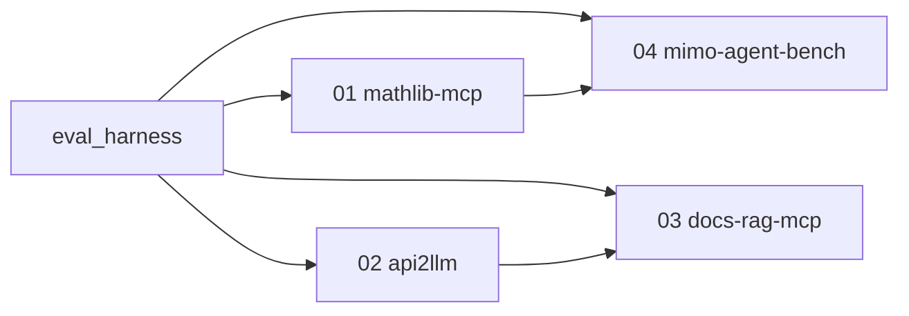

# agentic-math-tools

A single portfolio repository showing how numerical-library APIs can be made usable by AI agents: through interface design (`mathlib-mcp`), automated conversion (`api2llm`), documentation retrieval (`docs-rag-mcp`), and rigorous measurement (a shared harness, with a domain-specific case in `mimo-agent-bench`).

## Status

Updated 2026-10-12. The repository skeleton is in place. Every project is **In progress**. No feature milestone is implemented, and no evaluation has been run.

| Project | What it does | Status | Evidence |
|---|---|---|---|
| shared eval harness | Run tasks under controlled conditions and record comparable metrics | In progress | not run |
| 01 mathlib-mcp | Expose numerical tools to agents and measure whether LLM-first design improves reliability | In progress | not run |
| 02 api2llm | Generate agent-ready artifacts from a Python library and score readiness | In progress | not run |
| 03 docs-rag-mcp | Serve version-pinned library docs to agents and measure retrieval | In progress | not run |
| 04 mimo-agent-bench | Benchmark agents on MIMO estimation and linear detection | In progress | not run |

## How the projects relate



The harness is shared so conditions stay comparable. Project 04 calls the complex solvers from project 01. Project 03 may reuse the extractor from project 02. The full diagram and the one-page explanation are in [`docs/architecture.md`](docs/architecture.md). The specification is [`docs/SPEC.md`](docs/SPEC.md).

## Quick start

Requires Python 3.11+ and [`uv`](https://docs.astral.sh/uv/).

```bash
uv sync --all-packages
uv run pytest
uv run ruff check .
```

`make test` and `make lint` run the same checks. `make dryrun` and `make docs` print `not run` until those commands exist.

## Results

not run

## Limitations

Samples in the specification are small, numerics are NumPy and SciPy, and reported runs will use one configured model at a time. This skeleton does not yet contain tools, tasks, or logs.

## GPU math libraries

The four projects are a stand-in for making libraries such as cuFFT, cuBLAS, cuSOLVER, and cuSPARSE usable by agents: design the interface, generate it from the API, retrieve the matching docs, and measure whether agents use them correctly. A GPU backend is optional later and is not required for the results.
