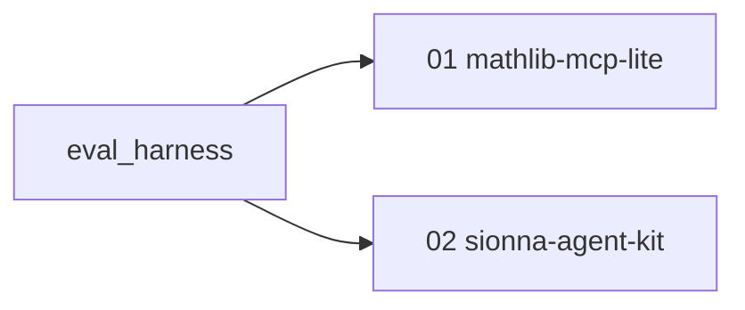

# agent-ready-libs

A small portfolio that shows one method: make a numerical library easier for an AI agent to use, then measure whether that helped. Two worked examples are in scope. A tiny math-library server is the method in its simplest form. A named slice of NVIDIA Sionna is the same method on real, domain-specific software.

The repository describes only what is in it. Roadmap items are Planned until they are built.

## Status

Updated 2026-10-14.

| Project | What it does | Status | Evidence |
|---|---|---|---|
| shared eval harness | Run tasks under controlled conditions, check answers, and record rewards | In progress | not run |
| 01 mathlib-mcp-lite | Five numerical tools as an MCP server, with generated docs and an evaluation | In progress | not run |
| 02 sionna-agent-kit | Agent-ready layer and evaluation for one OFDM MIMO slice of Sionna PHY | Planned | not run |

**Scope of the repository.** It covers the shared harness, the five-tool math server, and, when that work starts, one Sionna link slice. It does not cover a general API converter, a retrieval bake-off, GPU execution, or fine-tuning. Those are in [`docs/ROADMAP.md`](docs/ROADMAP.md).

## How the two projects relate



The projects are independent. Both are measured by the same harness. The diagram and a short explanation are in [`docs/architecture.md`](docs/architecture.md). The specification is [`docs/SPEC.md`](docs/SPEC.md).

## Quick start

Requires Python 3.11+ and [`uv`](https://docs.astral.sh/uv/).

```bash
uv sync --all-packages
uv run pytest
uv run ruff check .
```

`make test` and `make lint` run the same checks. `make dryrun` prints `not run` until the evaluation command exists.

## Results

Evaluation results: not run.

The harness has milestones H1 and H2: a fake model client, the agent loop, run logs, three checkers, a code sandbox, an MCP executor, and a provider client. No evaluation has been run. Project 01 is a package skeleton. Its five tools are not implemented. Project 02 has not been started.

## Limitations

Samples in the specification are small, and reported runs will use one configured model at a time. Sionna simulations, when they exist, are CPU-sized. No fine-tuning has been done.

## Roadmap

See [`docs/ROADMAP.md`](docs/ROADMAP.md).
