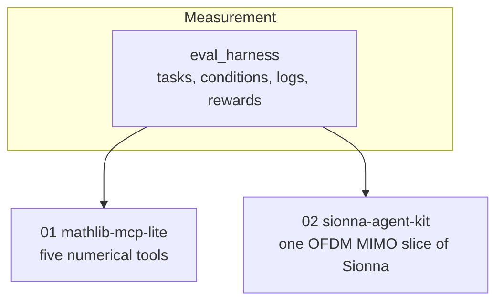

# How the projects relate

Two projects, one evaluation harness. The method is the same in both: give an agent a careful interface, then measure whether that interface changed the outcome.

`eval_harness` runs an agent loop under named conditions, checks the `FINAL_ANSWER` line, and writes one JSON line per run. Both projects use it. They do not depend on each other.

Project 01 is the method in its smallest form: five NumPy and SciPy tools, generated docs, and a 12-task comparison of no tools, brief tools, and fully described tools. Project 02 applies the same idea to one named slice of NVIDIA Sionna. Its tools are a tested link simulation plus keyword search over about 10–12 verified component pages.

Further ideas, including a general converter, a retrieval comparison, and a fine-tuning experiment, are listed in [`ROADMAP.md`](ROADMAP.md). They are Planned. The active specification is [`SPEC.md`](SPEC.md).
