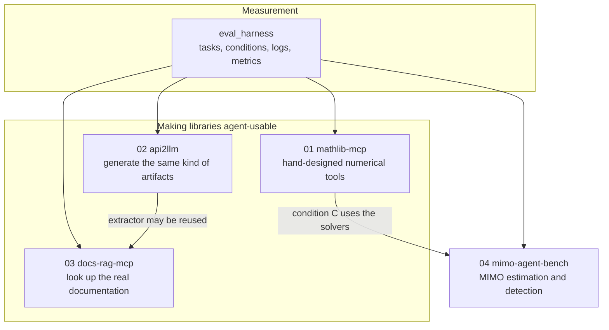

# How the projects relate

One repository, four projects, one evaluation harness. A reviewer can open this page and see which piece produces artifacts and which piece measures them.

`eval_harness` runs an agent loop under named conditions, checks answers, and writes one JSON line per run. Every project depends on it. Projects do not copy its code.

Project 01 offers eight numerical tools with descriptions, schemas, and errors aimed at agents, then measures that design against weaker descriptions and against raw code. Project 02 reads an importable Python module and emits the same kind of server, schemas, and pages, plus a readiness score. Project 03 indexes installed-package docstrings and serves search through three MCP tools. Project 04 is a small MIMO benchmark whose third condition calls project 01's complex solvers.

Build order follows those arrows: harness first, then project 01, then either project 02 or project 04. Project 03 comes after project 02 when it reuses that extractor. Current status for each project is **In progress**, recorded in that project's README. No evaluation numbers exist yet.
